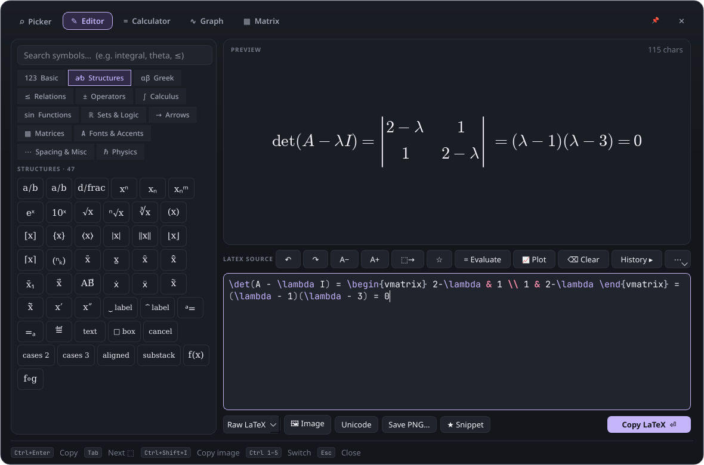
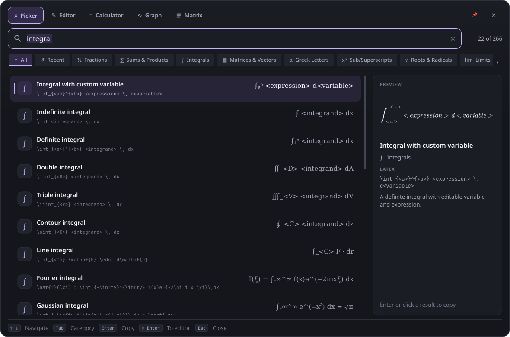
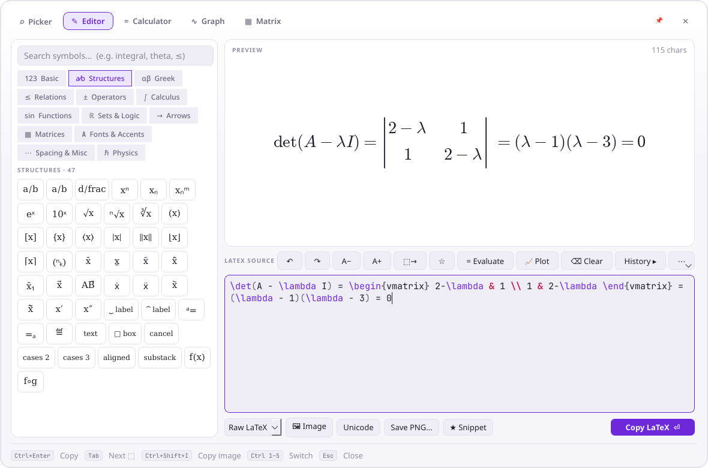
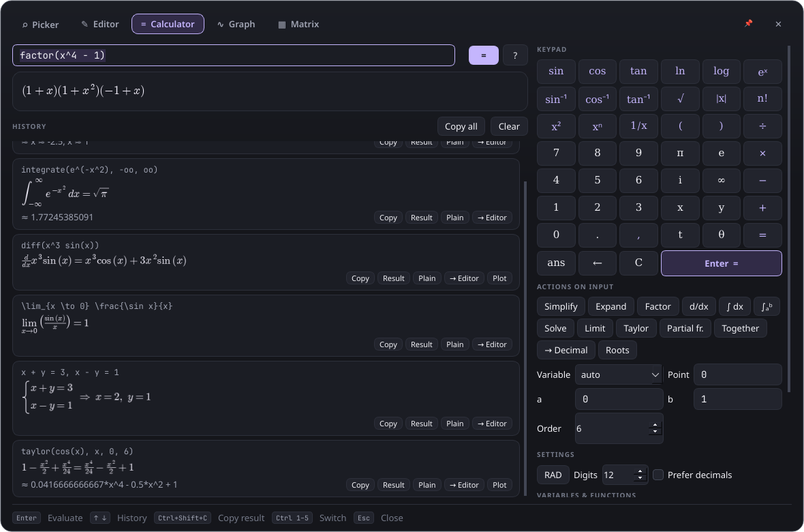
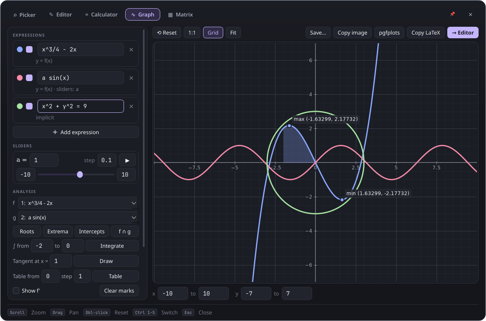
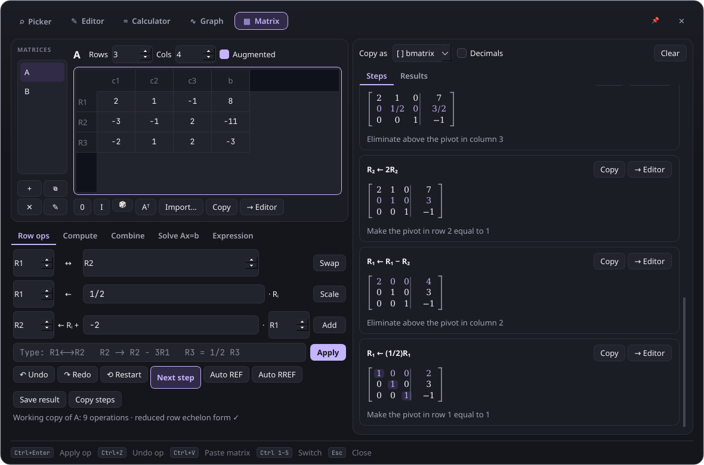
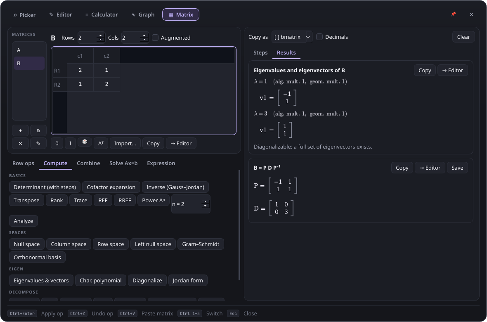
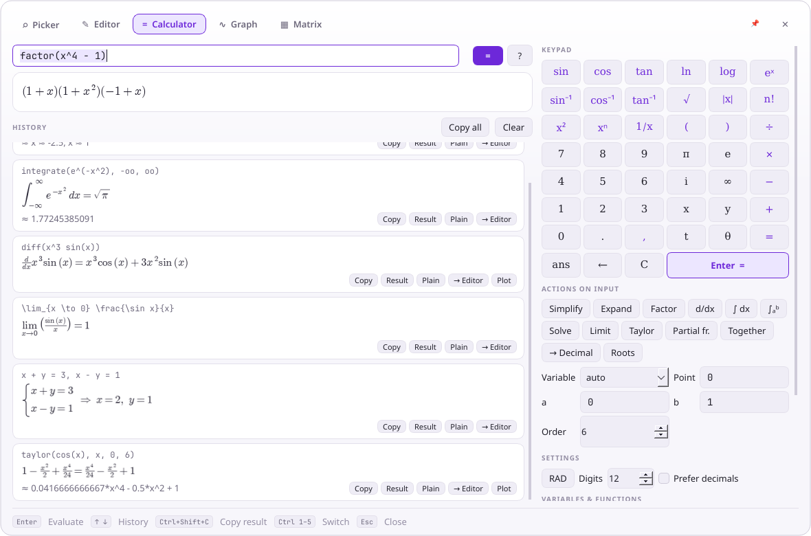
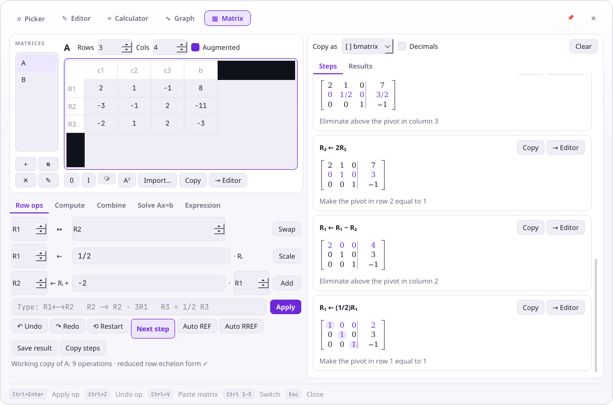

<div align="center">


# LaTeX Picker

**A keyboard-summoned math workspace for Linux.**
Search 266 LaTeX snippets, build equations by clicking, compute with a CAS,
plot graphs and row-reduce matrices — then copy clean LaTeX anywhere.

[](https://github.com/AbdelrhmanEbied/latex-math-workspace/actions/workflows/tests.yml)




</div>

Press **`Super + Shift + L`** from any app. A floating window opens with five
tools behind one shortcut:

| | Tab | In one line |
|---|---|---|
| ⌕ | **[Picker](#-picker)** | Fuzzy-search 266 curated snippets, press Enter, it's on your clipboard |
| ✎ | **[Editor](#-editor)** | Click ~490 symbol and structure buttons to build any equation, with a live typeset preview |
| = | **[Calculator](#-calculator)** | Exact symbolic math: solve, factor, differentiate, integrate, limits, series |
| ∿ | **[Graph](#-graph)** | Plot functions, curves and regions; find roots, extrema and intersections |
| ▦ | **[Matrix](#-matrix)** | Row operations, step-by-step Gaussian elimination, eigenvalues and decompositions |

Every tool speaks LaTeX: results copy as LaTeX, send to the editor with one
click, and the calculator even accepts pasted LaTeX as input.

## Contents

- [Tour](#tour) · [Installation](#installation) · [Global shortcut](#global-shortcut)
- [Keyboard reference](#keyboard-reference) · [Configuration](#configuration)
- [Adding your own snippets](#adding-your-own-snippets) · [Troubleshooting](#troubleshooting)
- [Architecture](#architecture) · [Development](#development) · [License](#license)

## Tour

### ⌕ Picker



The original emoji-picker-style popup. Type a few letters (`frac`, `integral`,
`\partial`, `alpha`), move with `↑`/`↓`, press **Enter**: the exact LaTeX
source is copied and the window closes.

- **266 snippets** in 12 categories: fractions, sums, integrals, matrices, Greek,
  scripts, roots, limits, operators, linear algebra, calculus, environments.
- Fuzzy, multi-word search over titles, keywords, commands and descriptions.
- Category chips (`Tab` cycles them), a **Recent** list, and a typeset preview.
- **`Shift+Enter`** sends the snippet to the Editor instead, with its
  `<placeholders>` converted into fillable ⬚ slots. Right-click for more.

### ✎ Editor

<table><tr>
<td></td>
<td></td>
</tr></table>

Build equations without remembering commands.

- **~490 buttons in 13 palettes**: Basic, Structures, Greek, Relations,
  Operators, Calculus, Functions, Sets & Logic, Arrows, Matrices,
  Fonts & Accents, Spacing, Physics, plus a search box across all of them.
- **Smart placeholders.** Templates insert ⬚ slots. `Tab` / `Shift+Tab` jump
  between them, and if text is selected it fills the first slot
  (select `x+1`, click √ → `\sqrt{x+1}`).
- **Matrix builder**: pick rows × columns, bracket style and fill
  (empty, zeros, identity, generic `a_{ij}`), including augmented `[A | b]`.
- **Live preview** with hints for unbalanced braces, mismatched
  `\begin`/`\end` or `\left`/`\right`, and unknown commands.
- Syntax highlighting, matching-brace highlight, bracket auto-close and
  `\command` completion (`\fr` → `\frac{⬚}{⬚}`).
- **Copy as** raw, `$…$`, `$$…$$`, `\[…\]`, `\(…\)`, `equation`,
  `equation*` or `align*` (`Ctrl+Enter`), as a **PNG image** to paste into
  chats and documents, or as Unicode text. Leftover ⬚ are stripped.
- History of copied equations, favorites, **★ Snippet** to save an equation
  into the Picker permanently, and **Evaluate** / **Plot** buttons that send
  it to the other tabs.

### = Calculator



A computer algebra system (powered by [SymPy](https://www.sympy.org)) with a
clickable keypad. Answers are **exact** (`√2/2`, not `0.7071…`), with the
decimal shown underneath.

| You type | You get |
|---|---|
| `2x^2 + 3x - 5 = 0` | `x = −5/2, x = 1` |
| `x + y = 3, x - y = 1` | `x = 2, y = 1` |
| `x^2 < 4` | `−2 < x < 2` |
| `diff(x^3 sin(x))` | `x³cos x + 3x²sin x` |
| `integrate(e^(-x^2), -oo, oo)` | `√π` |
| `\lim_{x \to 0} \frac{\sin x}{x}` *(LaTeX works too)* | `1` |
| `taylor(cos(x), x, 0, 6)` | `x⁴/24 − x²/2 + 1` |
| `f(x) = x^2 + 1` then `f(3)` | `10` |

- One-click actions on the current input: **Simplify, Expand, Factor, d/dx,
  ∫ dx, ∫ₐᵇ, Solve, Limit, Taylor, Partial fractions, Together, → Decimal,
  Roots**, with a variable picker.
- Friendly syntax: implicit multiplication (`2x`, `3sin x`), `|x|`, `5!`,
  `√2`, `π`, `30deg`, `15%`, `nCr`, `mean/median/std`, `gcd`, `isprime`…
- **RAD/DEG** modes, adjustable precision, variables and user functions,
  `ans`, `↑`/`↓` input history.
- History cards copy as LaTeX (`input = result`), result only, or plain text;
  send to the Editor; or **Plot** in one click. Slow computations run in the
  background and can be cancelled.

### ∿ Graph



A Desmos-style grapher on matplotlib.

- **Anything you can write:** `y = f(x)`, `x = g(y)`, parametric
  `(cos t, sin t)`, polar `r = 1 + cos(θ)`, implicit `x^2 + y^2 = 9`,
  inequalities `y > x^2` (shaded), points and point lists.
- **Sliders for free.** Any extra letter (`a sin(x)`) becomes a slider with
  editable range and step, and ▶ animates it.
- **Analysis:** roots, extrema, intercepts, intersections of two curves,
  definite integrals with shading, tangent lines, derivative overlay, tables
  of values. Every result has a copy button.
- Scroll to zoom around the cursor, drag to pan, double-click to reset, hover
  for a coordinate readout. Asymptotes (like `tan x`) are not joined.
- Export **PNG / SVG / PDF**, copy the image, or copy **pgfplots** code that
  reproduces the plot in your LaTeX document.

### ▦ Matrix

<table><tr>
<td></td>
<td></td>
</tr></table>

A linear-algebra workbench that shows its work.

- **Named matrices** (A, B, C…) in a grid editor, up to 10×10, with exact
  fractions and symbols. Paste `[1 2; 3 4]`, Python lists, rows of numbers or
  a LaTeX `bmatrix`. Toggle **augmented** `[A | b]`.
- **Row operations by hand**: swap `Rᵢ ↔ Rⱼ`, scale `Rᵢ ← k·Rᵢ`, add
  `Rᵢ ← Rᵢ + k·Rⱼ`, or type them (`R2 -> R2 - 3R1`). Undo/redo, plus a
  **Next step** button that picks the next Gauss–Jordan move and explains it.
- **Automatic REF / RREF** with every step listed. The row that changed is
  highlighted, pivots are marked, and **Copy steps** gives a ready-to-paste
  `aligned` chain with `\xrightarrow{R_2 \to R_2 - 3R_1}` arrows.
- **Compute:** determinant (by row reduction with steps, or cofactor
  expansion), inverse via `[A | I]`, rank, trace, transpose, powers, null /
  column / row / left-null spaces, eigenvalues with algebraic and geometric
  multiplicity, characteristic polynomial, diagonalization `PDP⁻¹`, Jordan
  form, LU (PLU), QR, Cholesky, SVD, Gram–Schmidt, adjugate, cofactor matrix,
  norms, condition number, and a property summary.
- **Solve `Ax = b`**: unique, infinitely many (general solution with free
  parameters) or inconsistent (with the least-squares solution), plus Cramer's
  rule.
- **Combine & expressions:** `X+Y`, `XY`, `kX`, Kronecker, Hadamard,
  commutator, and typed expressions like `A*B - 2C^T` or `inv(A)*B`.
- Copy any result as `bmatrix` / `pmatrix` / `vmatrix` / plain text /
  Python / MATLAB.

### Light theme

The app follows your system colour scheme (`"theme": "auto"`), or force
`dark` / `light`.

<table><tr>
<td></td>
<td></td>
</tr></table>

## Requirements

| Component | Needed | Notes |
|---|---|---|
| Linux with Wayland or X11 | yes | Developed on Hyprland/Wayland; GNOME, KDE, Sway and X11 work through Qt |
| Python ≥ 3.10 | yes | |
| PyQt6 ≥ 6.5 | yes | Installed from PyPI by `install.sh` if missing |
| sympy, numpy, scipy, matplotlib | yes | Calculator, grapher, matrices, previews; `install.sh` installs them if missing |
| `wl-clipboard` (Wayland) or `xclip` (X11) | recommended | Clipboard survives the window closing; also enables copying images |
| `texlive-latex` + `dvipng` | optional | Real-LaTeX previews; a built-in renderer is used otherwise |

```bash
# Arch / EndeavourOS
sudo pacman -S python python-pyqt6 python-sympy python-numpy python-scipy python-matplotlib wl-clipboard

# Debian / Ubuntu
sudo apt install python3 python3-pyqt6 python3-sympy python3-numpy python3-scipy python3-matplotlib wl-clipboard

# Fedora
sudo dnf install python3 python3-pyqt6 python3-sympy python3-numpy python3-scipy python3-matplotlib wl-clipboard
```

## Installation

```bash
git clone https://github.com/AbdelrhmanEbied/latex-math-workspace.git
cd latex-math-workspace
./install.sh --configure     # installs, then sets up Super+Shift+L
```

Or step by step:

```bash
./install.sh
```

This creates a private virtualenv at `~/.local/share/latex-picker/venv`, installs
the package, and adds:

- `~/.local/bin/latex-picker`
- `~/.local/share/applications/latex-picker.desktop`
- `~/.local/share/icons/hicolor/scalable/apps/latex-picker.svg`

Options:

```bash
./install.sh --configure      # also configure the shortcut and Hyprland rule
./install.sh --help
```

The virtualenv is created with `--system-site-packages`, so a distro-installed
PyQt6/matplotlib is reused. Missing PyQt6 is installed from PyPI. The app itself
never downloads anything at runtime.

Make sure `~/.local/bin` is on your `PATH`, then verify:

```bash
latex-picker --doctor
latex-picker --version
```

`--doctor` is the first place to look when something does not work. It reports
the session type, clipboard backend, Qt/Python versions, preview backend,
library counts, config path, and — on Hyprland — whether the floating-window
rule was found.

### Uninstalling

```bash
./uninstall.sh           # keeps config and recent items
./uninstall.sh --purge   # also removes ~/.config/latex-picker and state
```

## Global shortcut

### The important architectural point

On Wayland, an ordinary application **cannot** grab global keyboard shortcuts.
This is a deliberate security property of the protocol, not a missing feature.
LaTeX Picker therefore does not try to install an X11-style key grab. Instead,
your **compositor or desktop environment** owns the shortcut and launches the
app. This is also the most reliable approach on X11 and across desktops.

The helper script detects Hyprland, GNOME and KDE and prints or applies the
right configuration:

```bash
./scripts/configure-shortcut.sh            # dry run, prints what it would do
./scripts/configure-shortcut.sh --apply    # write the configuration
./scripts/configure-shortcut.sh --binding "SUPER + SHIFT + M" --apply
./scripts/configure-shortcut.sh --command /custom/path/latex-picker --apply
```

`latex-picker --shortcut-help` prints the same guidance for the current session.

### Hyprland

Recent Hyprland configurations may use either the classic `.conf` syntax or a
Lua-based configuration (for example Caelestia). The script detects which one is
present.

**Classic (`~/.config/hypr/hyprland.conf`):**

```ini
bind = SUPER SHIFT, L, exec, latex-picker
windowrulev2 = float,class:^(latex-picker)$
windowrulev2 = center,class:^(latex-picker)$
```

**Lua (`~/.config/caelestia/hypr-user.lua`, `~/.config/hypr/hypr-user.lua`, …):**

```lua
hl.bind("SUPER + SHIFT + L", hl.dsp.exec_cmd("latex-picker"))
hl.window_rule({ match = { class = "latex-picker" }, float = true, center = true })
```

Then reload:

```bash
hyprctl reload
```

The window rule matters: without it Hyprland tiles the popup like a normal
window. The rule intentionally does **not** set a fixed size — the app chooses a
size based on the monitor and clamps it to the available area.

### GNOME

GNOME on Wayland also requires the desktop to own the binding. Use
**Settings → Keyboard → View and Customize Shortcuts → Custom Shortcuts → +**,
or let the script register it:

```bash
./scripts/configure-shortcut.sh --apply
```

The script adds the keybinding path to the existing
`custom-keybindings` list instead of overwriting other custom shortcuts. The
equivalent manual commands are:

```bash
gsettings set org.gnome.settings-daemon.plugins.media-keys.custom-keybinding:/org/gnome/settings-daemon/plugins/media-keys/custom-keybindings/latex-picker/ name 'LaTeX Picker'
gsettings set org.gnome.settings-daemon.plugins.media-keys.custom-keybinding:/org/gnome/settings-daemon/plugins/media-keys/custom-keybindings/latex-picker/ command 'latex-picker'
gsettings set org.gnome.settings-daemon.plugins.media-keys.custom-keybinding:/org/gnome/settings-daemon/plugins/media-keys/custom-keybindings/latex-picker/ binding '<Super><Shift>l'
```

Remember to include the path in the `custom-keybindings` list; running the
script does this for you.

### KDE Plasma

Open **System Settings → Keyboard → Shortcuts → Custom Shortcuts**, create
**New → Global Shortcut → Command/URL**, set the trigger to `Super+Shift+L` and
the command to `latex-picker`. The installed desktop entry can also be assigned
a shortcut from the application launcher's context menu.

### Sway

```ini
bindsym Super+Shift+l exec latex-picker
for_window [app_id="latex-picker"] floating enable, move position center
```

### Other desktops and window managers

Bind your chosen key combination to the command `latex-picker` using your
desktop's keyboard settings (XFCE, Cinnamon, MATE, i3, etc.). The app does not
need to be running beforehand.

## Keyboard reference

**Everywhere**

| Key | Action |
|---|---|
| `Ctrl+1` … `Ctrl+5` (or `Alt+1…5`) | Picker · Editor · Calculator · Graph · Matrix |
| `Ctrl+Tab` / `Ctrl+Shift+Tab` | next / previous tab |
| `Esc` | close (your work in every tab is saved) |
| 📌 button | keep the window open when it loses focus |

**Picker**

| Key | Action |
|---|---|
| type | filter the library (fuzzy, every word must match) |
| `↑` `↓` / `PgUp` `PgDn` | move through results |
| `Tab` / `Shift+Tab` | next / previous category |
| `Enter` or click | copy and close |
| `Shift+Enter` / `Ctrl+Enter` | insert into the Editor |
| right-click | copy and keep open, insert into Editor, evaluate in Calculator |

**Editor**

| Key | Action |
|---|---|
| `Ctrl+Enter` | copy LaTeX in the selected format |
| `Tab` / `Shift+Tab` | next / previous ⬚ placeholder |
| `Ctrl+Shift+I` / `Ctrl+Shift+U` | copy as image / as Unicode |
| `Ctrl+F` | search the palettes |
| `Ctrl+H` | history and favorites |
| `Ctrl+D` | favorite the current equation |
| `Ctrl+=` / `Ctrl+-` | zoom the source |

**Calculator**: `Enter` evaluates, `↑`/`↓` recall earlier inputs,
`Ctrl+Shift+C` copies the last result.
**Graph**: scroll to zoom, drag to pan, double-click to reset.
**Matrix**: `Ctrl+Enter` applies a typed row operation, `Ctrl+Z` undoes it,
`Ctrl+V` in the grid pastes a whole matrix.

### What the Picker copies

The exact LaTeX source shown in the preview, for example
`\frac{<numerator>}{<denominator>}`. Placeholders are literal text and no `$…$`
delimiters are added; paste into the math context you already have. (The
Editor's copy formats add delimiters when you want them.)

### Clipboard behaviour

- **Wayland with `wl-copy`** (preferred): content survives the window closing.
  Images are copied as `image/png`.
- **X11 with `xclip`/`xsel`**: likewise handled by a clipboard owner process.
- **Qt fallback**: when no helper is installed, the process stays alive in the
  background for up to 60 s after closing so you can still paste.

The app never reads or modifies existing clipboard contents.

## Configuration

Configuration is optional. Create an example file with:

```bash
latex-picker --write-config
latex-picker --print-config-path      # ~/.config/latex-picker/config.json
```

```json
{
  "theme": "auto",
  "width": 1180,
  "height": 780,
  "close_on_blur": true,
  "tools_close_on_blur": false,
  "start_mode": "last",
  "show_preview": true,
  "preview_renderer": "auto",
  "font_scale": 1.0,
  "custom_snippets": "~/.config/latex-picker/snippets.json",
  "show_recent": true,
  "recent_limit": 12
}
```

| Key | Values | Meaning |
|---|---|---|
| `theme` | `auto`, `dark`, `light` | `auto` follows the system colour scheme |
| `width`, `height` | logical pixels | Window size, clamped to the monitor |
| `start_mode` | `last`, `picker`, `editor`, `calculator`, `graph`, `matrix` | Tab shown on launch |
| `close_on_blur` | boolean | Close the Picker when another window takes focus |
| `tools_close_on_blur` | boolean | Also close on focus loss while a tool tab is open (default `false`) |
| `show_preview` | boolean | Picker detail pane on wide windows |
| `preview_renderer` | `auto`, `unicode` | Picker preview: typeset image or Unicode only |
| `font_scale` | `0.8`–`1.6` | Scales the whole interface |
| `custom_snippets` | path or `null` | Your snippet file, merged over the built-in library |
| `show_recent`, `recent_limit` | boolean, `1`–`30` | The Recent category |

State lives in `~/.local/state/latex-picker/` (respects `XDG_STATE_HOME`):
`state.json` holds recent snippets and `workspace.json` holds each tool's
contents (editor text, calculator history and variables, plots, matrices).

### Command-line options

```bash
latex-picker --mode editor          # open a specific tab (bind several shortcuts!)
latex-picker --mode matrix
latex-picker --theme light
latex-picker --font-scale 1.15
latex-picker --width 1300 --height 850
latex-picker --no-preview
latex-picker --no-blur-close
latex-picker --snippets ~/my-math.json
latex-picker --doctor               # diagnostics
```

Tip: bind `latex-picker --mode calculator` to its own key for an instant
calculator, e.g. on Hyprland:
`hl.bind("SUPER + SHIFT + C", hl.dsp.exec_cmd("latex-picker --mode calculator"))`.

## Adding your own snippets

Create `~/.config/latex-picker/snippets.json`. The app merges it automatically
if that path exists (or set `custom_snippets` explicitly). You can also pass a
file with `--snippets`.

The file may be a list of snippets, or an object with optional `categories` and
a `snippets` list:

```json
{
  "categories": [
    {
      "id": "my-notation",
      "name": "My Notation",
      "symbol": "✎",
      "description": "Project-specific definitions"
    }
  ],
  "snippets": [
    {
      "id": "my-fourier-transform",
      "category": "my-notation",
      "title": "Fourier transform",
      "latex": "\\hat{f}(\\xi) = \\int_{-\\infty}^{\\infty} f(x) e^{-2\\pi i x \\xi} \\, dx",
      "description": "Unitary-frequency convention.",
      "keywords": ["fourier", "transform", "ft"],
      "preview": "f̂(ξ) = ∫ f(x) e^(−2πixξ) dx"
    }
  ]
}
```

Rules:

- `id` must be unique. Reusing a built-in ID **replaces** that snippet in place;
  a new ID is appended.
- `category` must exist in the built-in library or in your `categories` list.
- `title` and `latex` are required and non-empty.
- `keywords` may be a list or a whitespace-separated string.
- `preview` is optional; if omitted it is derived from the LaTeX.
- A malformed user file is reported as a warning and ignored; the built-in
  library still loads. Use `--debug` to see warnings.
- User category IDs unknown to the built-in library are appended to the chip
  bar.

The bundled library lives at
`src/latex_picker/data/snippets.json` if you want to contribute entries.

## Limitations

- Global shortcuts must be set up in your desktop or compositor; on Wayland an
  app cannot register them itself (`./scripts/configure-shortcut.sh` helps).
- Without a TeX installation, previews use matplotlib mathtext plus native
  drawing for matrices, `cases`, `array` and `aligned`. Rare packages (TikZ,
  `physics`, custom macros) preview as Unicode; copying is never affected.
- Wayland doesn't let apps position their own windows; centering comes from the
  compositor's window rule (added by the shortcut script on Hyprland).
- The calculator is as capable as SymPy: some integrals and equations have no
  closed form and are returned unevaluated or solved numerically.
- Tested mainly on Hyprland. GNOME, KDE, Sway and X11 use standard Qt paths.

## Troubleshooting

Start with:

```bash
latex-picker --doctor
```

**The shortcut does nothing.** Check that the command resolves in the
environment where the shortcut runs: use an absolute path such as
`/home/you/.local/bin/latex-picker`. On Hyprland run `hyprctl reload` after
editing the config. On GNOME verify the keybinding's path is present in the
`custom-keybindings` list.

**The window opens tiled or off-screen (Hyprland).** Add the window rule shown
above and reload. `--doctor` reports `Window rule NOT FOUND` when it is missing.

**Pasting yields nothing after the popup closes.** Install `wl-clipboard` on
Wayland (`wl-copy`). The Qt fallback keeps the process alive briefly, but
`wl-copy` is the reliable path.

**A tab shows "failed to load".** Its math libraries are missing from the
venv. Re-run `./install.sh`, which installs sympy, numpy, scipy and matplotlib
when they are not available system-wide. Hover the message for the traceback.

**Previews look different from my LaTeX document.** Without a TeX install the
app uses its built-in renderer (matplotlib mathtext + native matrix drawing).
Install `texlive-latex` and `texlive-latexrecommended` (Arch) or `texlive-latex-base`
and `dvipng` (Debian/Ubuntu) and previews switch to real LaTeX automatically.

**PyQt6 import errors.** Ensure the venv has PyQt6:
`~/.local/share/latex-picker/venv/bin/python -c "import PyQt6"`. Re-run
`./install.sh` to repair the environment.

**The window closes as soon as it opens.** Some tiling compositors steal focus
during startup. Set `"close_on_blur": false` temporarily; on Hyprland the
floating rule usually resolves it.

**Custom snippets are ignored.** Run with `--debug`; validation errors are
printed as warnings. Check that category IDs exist and that every snippet has a
unique ID, title and LaTeX source.

## Architecture

```
Global shortcut (compositor) ──▶ latex-picker  (one short-lived Python/Qt process)
                                   │
                                   ├── window.py ── tab bar, shortcuts, cross-tab links, state save
                                   │     ├── Picker      library · search · preview pane
                                   │     ├── Editor      palettes ─┐
                                   │     ├── Calculator  mathcore ─┼── sympy
                                   │     ├── Graph       plotting ─┼── numpy · scipy · matplotlib
                                   │     └── Matrix      linalg ───┘
                                   │
                                   ├── render.py ── LaTeX → image:  real LaTeX ▸ mathtext + native
                                   │                matrices/cases/aligned ▸ Unicode fallback
                                   └── clipboard.py ── wl-copy ▸ xclip/xsel ▸ Qt  (text and PNG)
```

The math lives in GUI-free modules that are unit-tested directly; the tabs are
thin Qt layers over them.

| Path | Responsibility |
|---|---|
| `src/latex_picker/ui/window.py` | Frameless window, tab bar, picker, cross-tab signals, persistence |
| `src/latex_picker/workspace/mathcore.py` | Input parser, LaTeX → SymPy translator, calculator session |
| `src/latex_picker/workspace/linalg.py` | Row operations, REF/RREF/inverse/determinant steps, solvers, decompositions |
| `src/latex_picker/workspace/plotting.py` | Plot classification, sampling, analysis, pgfplots export |
| `src/latex_picker/workspace/render.py` | Three-tier LaTeX renderer with a background service |
| `src/latex_picker/workspace/palettes.py` | The Editor's button palettes |
| `src/latex_picker/workspace/*_tab.py` | The Editor, Calculator, Graph and Matrix tabs |
| `src/latex_picker/workspace/widgets.py` | Shared tab base class, math label, flow layout |
| `src/latex_picker/search.py`, `library.py` | Picker search scoring and snippet loading/merging |
| `src/latex_picker/config.py` | Config, state and workspace persistence (atomic JSON writes) |
| `src/latex_picker/clipboard.py` | Clipboard backends for text and images |
| `src/latex_picker/data/snippets.json` | The bundled snippet library |

Design notes:

- **No daemon.** Each shortcut press starts a fresh process, so nothing runs in
  the background. Tool tabs are created lazily the first time you open them,
  which keeps the Picker's startup fast.
- **Wayland-friendly.** The compositor owns the shortcut and window placement;
  the app never grabs keys globally.
- **Never blocks.** Rendering and heavy CAS / matrix computations run on worker
  threads; stale results are discarded.
- **Your work persists.** Each tab serializes its state on close and restores
  it on the next launch. Corrupt state is ignored, never fatal.

## Development

Run from the source tree without installing:

```bash
./bin/latex-picker                  # adds src/ to PYTHONPATH
./bin/latex-picker --mode graph
```

Run the test suite (166 tests, headless):

```bash
QT_QPA_PLATFORM=offscreen python3 -m unittest discover -s tests -v
```

Regenerate the README screenshots (renders the real app offscreen, with a
throwaway state directory):

```bash
python3 scripts/screenshots.py --light
```

| Test file | Covers |
|---|---|
| `test_calc.py` | Parser, LaTeX translation, equations, systems, degree mode, calculator tab |
| `test_matrix_tab.py` | Row-op parsing, REF/RREF replay, inverse, solve classification, decompositions, matrix tab |
| `test_plotting.py` | Plot kinds, sliders, discontinuities, roots/extrema/intersections, pgfplots, graph tab |
| `test_editor.py` | Palettes, placeholders, copy formats, snippet saving, editor tab |
| `test_render.py` | Matrix/cases/array/aligned rendering, error hints |
| `test_ui.py`, `test_search.py`, `test_library.py`, … | Picker, search ranking, library validation, config, clipboard |

## Roadmap

- Import/export snippets from UltiSnips, VS Code and TeXstudio.
- Unit conversions and complex-number plots in the calculator.
- 3D surface plots.
- Flatpak and AUR packages.
- Interface translations.

## License

MIT. See [LICENSE](LICENSE).
